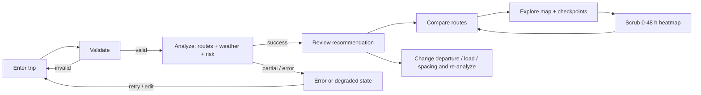

# 02 — User Flows

Primary user: a truck driver or dispatcher, often on a phone, who wants to know **which of three routes is safest to drive at a given time with a given load** and why.
Requirement IDs refer to `01-requirements.md`. Layout details are in `06-ui-ux-spec.md`.

## 1. Journey overview

## 2. Flows

### 2.1 Trip planning (R-IN-01..03)

1. User lands on one screen: form on the left (desktop) / top sheet (mobile), empty map behind it.
2. Fields: **Origin**, **Destination** (autocomplete, US), **Departure date & time** (defaults to the next full hour), **Load weight (lb)**, **Checkpoint spacing** (segmented control 10 / 25 / 50 mi, default 25).
3. Origin/destination: typing ≥3 characters (debounced 300 ms) shows up to 5 suggestions. User must pick a suggestion or press Enter to geocode the typed text; selection stores label + coordinates. A swap button exchanges the two.
4. Submit button label: **Analyze routes**. It is disabled while a request is in flight.
5. Validation (inline, on blur and on submit; same rules as server, A-09):
   - Origin/destination required, and must resolve to coordinates; must differ (distance > 1 mi).
   - Departure within [now − 1 h, now + 7 days].
   - Load is a number, 1–100,000 lb. A helper text shows the thresholds that matter ("Wind rules change above 30,000 and 40,000 lb").
6. On submit: form collapses to a summary chip row (origin → destination · departure · load · spacing) with an **Edit** button; results panel opens.

### 2.2 Route analysis (R-RT-01, R-WX-02, R-RK-01)

The analysis is one POST (see `04`), so the server reports no intermediate stages. The UI therefore shows an **indeterminate** progress bar with the fixed text "Analyzing routes and forecast" and skeleton cards in the results panel; no fake percentages or invented step names. After 5 s the elapsed time is shown.
- Success: results appear, recommended route is auto-selected, map fits the three routes.
- The analysis may take long for 1,500+ mile trips at 10-mile spacing (weather rate limits, `03` §6). After 8 s the UI adds "Long trip: still working" and a Cancel button (aborts the request).

### 2.3 Route comparison (R-REC-01/02, R-MAP-03)

- Route cards, sorted by rank: rank badge, **Recommended** tag on rank 1, name (e.g. "Route A · via I-80"), duration, distance, ETA at destination, a stacked bar of miles by risk level, worst level, average risk.
- A **Why recommended** line explains the deciding ranking key in plain language, e.g. "0 Severe miles vs 24 on Route B" or "Tied on risk; 18 min faster". Generated from the ranking keys, never from an LLM.
- A compare table (desktop) / swipeable cards (mobile) lists the four ranking keys side by side with the winning cell marked.
- Selecting a card selects the route on the map; selecting a map line selects the card. Only one route is "selected" at a time; all remain visible, non-selected dimmed.
- If a route has No Travel, its card shows a **Blocked** state with the first blocked checkpoint ("No Travel near mile 142 at 03:10 · wind 57 mph"). Blocked and incomplete-data routes are never labelled **Recommended**; eligibility (blocked/incomplete/eligible) is decided before ranking by a separate policy step and is never a ranking key itself (`05` §8) — ranking only ever compares routes within the same eligibility group on the PDF's four keys (`05` §9).

### 2.4 Map exploration (R-MAP-01/02)

- Pan and zoom are enabled; rotation and pitch are disabled (fewer accidental gestures on touch).
- Routes drawn as lines; selected = thick with risk-colored segments, unselected = thin grey-blue. Each route carries an on-map label (route number · duration · distance); clicking the line or label opens a route summary popup (distance, duration, arrival, miles by level, average risk) — this is the "route summaries on a map" of R-MAP-03.
- Checkpoints drawn as dots colored by level with a shape/icon distinct per level (not color alone); at low zoom only Moderate+ checkpoints draw, plus origin/destination, to avoid clutter; all draw at zoom ≥ 8.
- Tap/click a checkpoint → popup: mile marker, ETA (browser time zone + abbreviation), level badge, wind/rain/snow values with units, which condition drove the level, whether a load rule applied, forecast hour used. Keyboard: the same data is in the checkpoint table.
- **Checkpoint table** under the map (desktop: side tab; mobile: bottom sheet tab) lists all checkpoints of the selected route; selecting a row flies to the point.
- Controls: zoom ±, "Fit routes", layer toggle for heatmap, fullscreen map on mobile.

### 2.5 Forecast slider and heatmap (R-HEAT-01/02)

- Slider range 0–48 h after departure, step 1 h, default 0. Label shows the absolute time ("Thu 14:00 EDT · +6 h").
- Dragging updates the heatmap immediately from data already in the browser (D-09, D-14). It never touches the recommendation, the route cards, the ranking, or any checkpoint's risk badge — those answer "what will the truck meet when it arrives," the slider answers "what will this spot look like at a time I pick," and the two are allowed to disagree for the same place without either being wrong (`06` §6). Release/keyboard step also announces the new time via `aria-live` (debounced).
- Play/pause button animates +1 h per 600 ms; stops at 48; respects `prefers-reduced-motion` (animation disabled, stepping only).
- Heatmap legend: five levels with labels + patterns; a footnote states "Forecast model data; classified with your load of 32,000 lb".
- Heatmap shows conditions at departure + h for the whole corridor, **not** the truck's position. A short helper says "Conditions at the time shown. Checkpoint risks use each checkpoint's own arrival time."
- Changing the load weight or spacing requires a new analysis (risk depends on both).

### 2.5.1 Re-analysis

Edit → change any field → Analyze again. Previous results stay visible (dimmed, "Out of date") until new results replace them; failed re-analysis keeps old results with an error banner.

## 3. States

| Area | Loading | Empty | Error | Notes |
|---|---|---|---|---|
| Autocomplete | inline spinner in field | "No matches" row | "Couldn't search places. Press Enter to try the typed text." | Debounced; cancels stale requests |
| Analyze | skeleton cards + stepper | initial screen: map + "Enter a trip to compare routes" | see §4 | single POST |
| Route cards | skeletons | n/a | banner | |
| Map | tile skeleton / spinner overlay; app usable before tiles load | blank basemap | "Map couldn't load. Route list and checkpoint table still work." | map chunk is lazy; list works without it |
| Heatmap | layer shows spinner only if data pending | "No forecast data for this time" (hours with no data are rendered as hatch, never as Low) | "Forecast unavailable for part of the corridor" | missing ≠ Low |
| Checkpoint popup | n/a | n/a | "Weather unavailable at this point" with level "Unknown" | Unknown is a distinct state |

## 4. Failure and degraded states (N-07)

| Code (see `04`) | When | User-facing behavior |
|---|---|---|
| `VALIDATION_ERROR` | bad input | field errors, focus the first invalid field |
| (client-side) no suggestion | Enter pressed on typed text and `/api/places/suggest` returns no results | message under the field, "Try a city, ZIP or full address"; no analyze request is sent |
| `NO_ROUTE` | provider finds no route (e.g. ocean) | "No driving route found between these places" |
| `ROUTES_FEWER_THAN_3` (warning, not an error) | provider returned 1–2 routes | results shown; notice "Only 2 distinct routes available for this trip" |
| `WEATHER_UNAVAILABLE` | weather provider down after retries | no risk can be computed → error screen with Retry; no silent fallback to "Low" |
| `WEATHER_PARTIAL` (warning) | some points failed | affected checkpoints show **Unknown**; routes containing Unknown checkpoints show "Incomplete data" and are ranked below complete routes with equal keys (see `05` §9) |
| `RATE_LIMITED` | provider/our throttle | "Too many requests right now. Try again in {n} s" with countdown |
| `FORECAST_HORIZON_PARTIAL` (warning) / `FORECAST_HORIZON` (error if nothing is covered) | ETA beyond available forecast | affected checkpoints Unknown; message names the horizon |
| `UPSTREAM_TIMEOUT` | provider timeout | Retry button; inputs preserved |
| `INTERNAL_ERROR` | bug | generic message with request id for support |
| Network offline | fetch fails | "You appear to be offline" + Retry |
| Backend cold start | first request slow (free-tier hosting) | after 5 s: "Waking up the server, this can take up to a minute on first use" |
| All routes blocked (No Travel) | every route has No Travel | `fallback_level = "no_safe_route"`; banner "No safe route for this departure time and load" + least-bad blocked route marked (never "Recommended"); suggestion to change departure time |
| No eligible route, but not all blocked | every route has ≥1 unknown checkpoint, none has a No Travel checkpoint | `fallback_level = "incomplete_data"`; banner "No route has complete weather data; showing the best available with partial data" + best incomplete route marked "Not confirmed safe" |

## 5. Interaction details that affect correctness

- Checkpoint ETAs and the slider use different clocks on purpose (see §2.5). Both are labelled.
- The recommended route is a function of (route set, forecast, load, spacing, departure); any change invalidates results.
- Risk colors AND shapes/labels everywhere (N-04). Unknown is neutral grey with a "?" mark.
- Copy is plain operational language ("Severe wind near mile 212"), never marketing text.

## 6. Mobile-specific behavior

- Form is a collapsible top sheet; results are a bottom sheet with three snap points (peek: recommendation; half: route cards; full: table). Map stays visible behind it.
- Slider is a full-width control pinned above the bottom sheet with a 44 px touch target for the thumb.
- Popups become a bottom card (not a floating popup that clips).
- One-handed use: primary actions (Analyze, Edit, play) are in the lower half.
