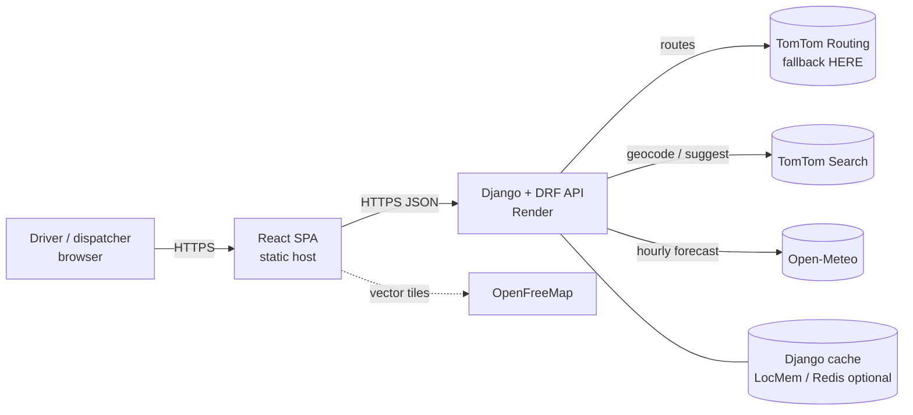
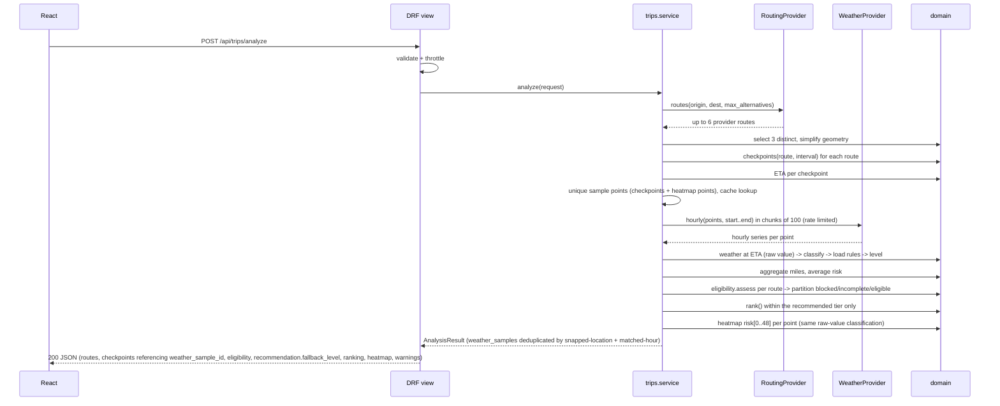
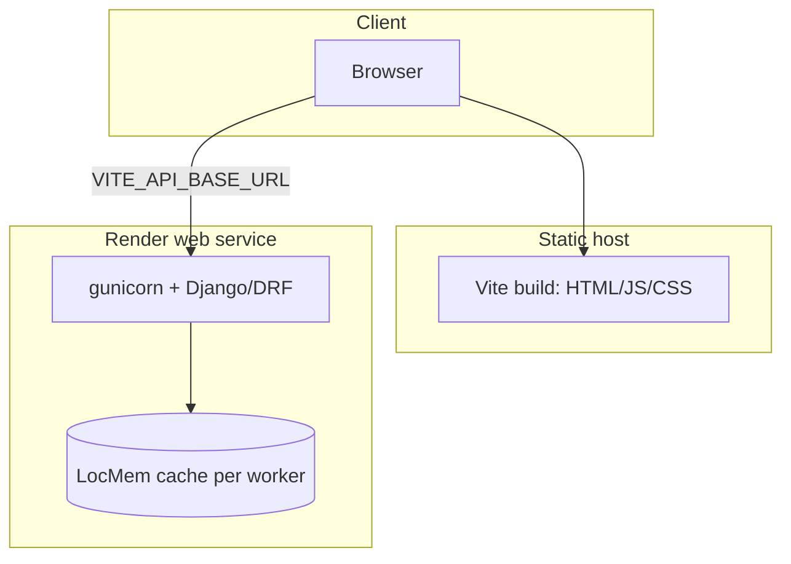

# 03 — Architecture

Skills applied: `senior-architect` (decisions, boundaries), `senior-backend` (Django/DRF, validation, throttling, caching), `strict-api` (provider claims backed by evidence), `react-best-practices` (frontend performance).
Where a skill's default conflicts with the assessment, the assessment wins. Overrides are listed in §10.

## 1. Stack (and what is required vs chosen)

| Layer | Choice | Required by PDF? |
|---|---|---|
| Frontend | React 18/19 + TypeScript (strict) + Vite + Material UI | React: **yes**. TS/Vite/MUI: role emphasis, your instruction |
| Map | MapLibre GL JS with OpenFreeMap vector tiles | chosen |
| Backend | Python 3.12, Django 5, Django REST Framework | Django: **yes**. DRF: your instruction |
| Domain logic | Pure Python package (no Django imports) | chosen — makes the 40%-weight logic testable in isolation |
| Persistence | **None.** Stateless API, cache only | chosen (no requirement to store anything) |
| Routing / geocoding | TomTom APIs (primary, provisional), HERE (fallback) | "a routing API": yes; vendor: chosen |
| Weather | Open-Meteo forecast API | "weather API": yes; vendor: chosen |
| Tests | pytest (+ Hypothesis for boundaries), Vitest + React Testing Library, Playwright | chosen |
| Hosting | Render (API), static host for the SPA (Vercel/Netlify/Render Static) | "hosted application": yes; vendor: chosen |

## 2. Provider feasibility (evidence)

Evidence level: **LIVE** = I called it in this session. **DOCS** = official docs read in this session. **3RD** = third-party/search snippet only. **UNVERIFIED** = must be confirmed in Gate 0 (`08` M0).
The provider decision is **provisional** until Gate 0 passes, because routing providers need keys that I could not use.

### 2.1 Routing (R-RT-01: three routes)

| Provider | Truck mode | Alternatives | Max distance / limits | Free tier | Evidence | Verdict |
|---|---|---|---|---|---|---|
| **TomTom Routing (Calculate Route)** | vehicle params documented (`vehicleWeight`, `vehicleLength/Width/Height`, `vehicleCommercial`) and `travelMode` param exists; the `truck` value is **UNVERIFIED** | `maxAlternatives` 0–5, "fewer may be returned" (DOCS) | not checked | "Free 20K monthly", no credit card (pricing page, DOCS) | DOCS + pricing; no key | **Primary (provisional)** |
| **HERE Routing v8** | `transportMode=truck` (DOCS) | `alternatives` 0–6 (DOCS); each alternative is billed as a transaction (2020 notes, 3RD) | not checked | Base Plan needs a credit card; current Routing quota **UNVERIFIED** | DOCS partial | **Fallback** |
| Mapbox Directions | **no truck profile** (driving, driving-traffic, cycling, walking) (DOCS) | up to 2 alternatives → max 3 routes (DOCS) | 300 req/min; 10,000 km per route (DOCS) | "100k/month" (3RD) | DOCS partial | Possible; not truck-aware |
| Valhalla (FOSSGIS public) | `costing: truck` works (LIVE) | `alternates: 2` returned **1 to 3** routes depending on the city pair (LIVE, table below) | **1,500 km max** (HTTP 400, error 154) (LIVE) | keyless; "fair use / dev-test" (3RD, no official page found) | LIVE | **Rejected** for production: fails long-haul, no SLA |
| OSRM public demo | car only | `alternatives=3` returned 1 route on Denver→Omaha (LIVE) | demo server | keyless | LIVE | **Rejected** |
| OpenRouteService | `driving-hgv` exists | alternatives only for routes **< 100 km** per ORS team (3RD forum) | 100 km | key | 3RD | **Rejected** for long-haul |

Live Valhalla alternates test (truck costing, `alternates: 2`):

| Trip | Routes returned | Miles | Overlap of alt vs main |
|---|---|---|---|
| Denver→Omaha | 3 | 546 / 550 / 555 | 0.64 / 0.49 |
| LA→Phoenix | **1** | 374 | – |
| Chicago→Atlanta | 3 | 758 / 723 / 691 | 0.40 / 0.48 |
| Seattle→Salt Lake City | 3 | 837 / 929 / 1000 | 0.57 / 0.24 |
| Dallas→Houston | **1** | 240 | – |
| NYC→Boston | **2** | 220 / 230 | 0.47 |
| Boston→LA | **error** (>1,500 km) | – | – |

**Finding:** no routing API guarantees three alternatives for every trip. The design therefore (a) asks the provider for the maximum alternatives, (b) selects up to 3 most distinct routes by geometric overlap (`05` §2), and (c) reports honestly when fewer exist (A-03, AC-02). Gate 0 re-runs this table against TomTom and, if needed, HERE with the user's keys, using the same trip list, scored against the explicit checklist in `08` §4.1 (alternatives, geometry, distance/duration, truck support, quota, failure behaviour) rather than an informal re-read of this table.

Route-time detail: ETAs at checkpoints need time-vs-distance along the route. Neither provider's basic response was verified to include per-point cumulative time. Baseline = linear interpolation by distance over the route's total duration (A-06); Gate 0 checks whether the provider's section/instruction data gives better cumulative times (HERE `spans`/sections or TomTom guidance offsets — **UNVERIFIED**).

### 2.2 Weather (R-WX-01/02, R-RK-*, R-HEAT-*)

| Capability needed | Open-Meteo | Evidence |
|---|---|---|
| Wind in mph | `wind_speed_unit=mph` → unit `mp/h` | LIVE |
| Rain / snow in inches per hour | `precipitation_unit=inch` → `rain`, `showers`, `snowfall` in `inch`; **default snowfall is cm** | LIVE |
| Hourly resolution | hourly arrays, ISO or unix time (`timeformat=unixtime`) | LIVE |
| Variable meaning | `wind_speed_10m` = instantaneous; `rain`, `showers`, `snowfall` = **sum of the preceding hour**; `wind_gusts_10m` = max of the preceding hour | DOCS |
| Forecast horizon | up to 16 days (`forecast_days` 0–16; 384 hourly values returned; 17 rejected); series starts **today 00:00 UTC** | LIVE |
| Many points per request | comma-separated coordinates return an array; 400 locations in one GET took 1.7 s (URL ≈ 5 KB) | LIVE |
| Free-tier limits | <10,000 calls/day, 5,000/hour, 600/minute; non-commercial only; rate limits applied per IP, shared hosts (Render, Vercel) may be limited sooner; CC BY 4.0 attribution | DOCS |
| Per-location counting | After ~750 locations in a few seconds my next calls returned "Minutely API request limit exceeded" — consistent with locations counting toward the 600/min limit | LIVE (observed, not documented explicitly) |
| Corridor coverage | any lat/lon; model resolution varies by region | not measured |

**Consequences**
- Always request `precipitation_unit=inch` and `wind_speed_unit=mph`; never convert ourselves (removes a unit-error class). A unit test asserts the request URL.
- Rain intensity = `rain + showers`; not `precipitation`, which includes snow water equivalent and would double count snow (A-04).
- Precipitation values describe the hour **ending** at the timestamp → matching rule in `05` §4.
- The 600/min limit is the binding constraint: one trip can need hundreds of locations (3 routes × miles/spacing). The weather client dedupes points, caches, chunks (≤100 locations per request) and applies a shared rate limiter; trips above the budget degrade as in §6.
- Free tier is "non-commercial": acceptable for an assessment; documented in the README. The production path is a paid key (config only).

### 2.3 Geocoding and tiles

| Need | Choice | Evidence |
|---|---|---|
| Geocode + suggestions | TomTom Geocoding / Places Search Suggest; free monthly quotas listed on TomTom's pricing page (Geocoding ≈ 20K, Suggest ≈ 10K; the page text was ambiguous, confirm in Gate 0) | pricing page (DOCS), endpoints UNVERIFIED |
| Basemap | OpenFreeMap vector style `https://tiles.openfreemap.org/styles/liberty` — returned a valid style (sources `ne2_shaded`, `openmaptiles`), keyless | LIVE (style only; tile fetch and terms to re-check at M3) |
| Fallback basemap | TomTom Map Display vector tiles, free 200K/month (pricing page) | DOCS |

### 2.4 Provider abstraction (so a failed Gate 0 costs minutes, not hours)

```python
class RoutingProvider(Protocol):
    def routes(self, origin: LatLng, dest: LatLng, *, max_alternatives: int) -> list[ProviderRoute]: ...
class WeatherProvider(Protocol):
    def hourly(self, points: Sequence[LatLng], start: date, end: date) -> dict[LatLng, HourlySeries]: ...
class GeocodingProvider(Protocol):
    def suggest(self, q: str, *, limit: int) -> list[Place]: ...
```
Implementations: `TomTomRouting`, `HereRouting`, `OpenMeteoWeather`, `TomTomGeocoding`, plus `Fixture*` doubles that replay recorded real responses for tests and offline E2E. Provider selection by env var.

## 3. System context



## 4. Backend structure and boundaries

```
backend/
  config/                 settings, urls, wsgi
  domain/                 PURE PYTHON, no Django, no network  (40% of grade lives here)
    models.py             frozen dataclasses: LatLng, RouteGeometry, Checkpoint, WeatherSample, RiskLevel...
    geo.py                haversine, cumulative distance, point-at-distance, RDP simplify, polyline encode
    checkpoints.py        generate(route, interval_mi)
    eta.py                eta_at_distance(route, departure, d)
    weather_match.py      sample_at(series, t)  (interpolate / ceil-hour bucket)
    risk.py               THRESHOLDS table, classify(), apply_load_rules(), checkpoint_risk()
    aggregate.py          mile attribution, miles_by_level, average_risk
    eligibility.py        assess(route) -> blocked/incomplete/eligible; partition_by_eligibility(routes) (05 §8 — separate from ranking)
    ranking.py            rank(routes_in_one_tier) -> ordered on the PDF's 4 keys only, + reasons (05 §9; never sees mixed tiers)
    heatmap.py            build(points, series, load, departure, hours=49)
    selection.py          choose_three_distinct(routes)
  providers/              adapters; all network I/O and unit conversions live here
    routing/{base,tomtom,here,fixture}.py
    weather/{base,open_meteo,fixture}.py
    geocoding/{base,tomtom,fixture}.py
    http.py               shared session, timeouts, retries, key redaction
  trips/
    serializers.py        request/response schemas, validation
    views.py              thin DRF views
    service.py            orchestration: routes -> select -> checkpoints -> weather -> risk -> rank -> heatmap
    errors.py             typed exceptions -> DRF exception handler -> {error:{code,message,...}}
  tests/                  pytest; fixtures/ recorded provider responses
```

Rules:
1. `domain/` imports nothing from Django, `requests`/`httpx`, or `providers/`. It takes plain data and returns plain data.
2. `providers/` never contain business rules. They return domain dataclasses with SI→US units already normalised and documented in the type (`wind_mph`, `rain_in_per_hr`).
3. `service.py` is the only place that wires provider output into domain functions.
4. Views contain no logic beyond serializer validation and calling the service.

## 5. Data flow (analyze)



One request returns everything the UI needs (routes, checkpoints, recommendation, heatmap for 0–48 h) so the slider never hits the network (D-09, D-14). Payload budget: ≤ 400 KB uncompressed JSON for a 3,000-mile trip at 10 mi spacing; geometry is simplified (RDP, ~50 m tolerance) and polyline-encoded; heatmap risk stored as small integers (0–4, 255 = unknown); weather readings are stored once per unique (snapped location, matched hour-pair) in `weather_samples` and referenced by id from each checkpoint, rather than repeated inline per route (`04` §4, D-15) — the main lever for staying under budget on trips whose kept alternates share a long common corridor.

## 6. Weather call budget and degradation

- Unique locations per trip ≈ checkpoints across 3 routes (shared trunk sections collapse after rounding to 0.05°) + heatmap points. Rounded coordinates are the cache key together with date range and units.
- Budget: **≤ 450 unique locations per analysis** (leaves margin under 600/min). A shared in-process limiter (token bucket, 500 locations/min) spaces chunks.
- If the budget is exceeded: first snap checkpoint weather lookups to a 0.05° grid (shared trunk sections collapse); if still above budget, the API returns `422 TOO_MANY_CHECKPOINTS` with the smallest spacing that fits (for example "use 25 mi for this trip"). Rough capacity at 10-mile spacing: about 1,450 route-miles per route (450 locations ÷ 3 routes × 10 mi) before overlap savings, so most regional trips work and only cross-country trips need 25 or 50 miles. This is a free-tier provider limit, not a logic limit; it is disclosed in the README and in the UI error, and a paid weather key removes it (config only).
- Heatmap points are the same locations as the checkpoints of the selected spacing (no additional weather calls beyond what checkpoints already need), plus lateral points only if the budget allows (`09` D-07, stretch S-01). Explicitly budgeted: if `N` = unique checkpoint locations across the 3 kept routes, S-01 lateral points add up to `N` more (one pair of ±15 mi points per checkpoint on the recommended route, roughly 2× its checkpoint count) and are only requested while `N + lateral_count ≤ 450`; S-01 is dropped first (it is already the first scope cut, C-0 in `08` §5) whenever this would exceed the budget, so a heatmap always exists, only its lateral width is lost.
- **Rate limits (reviewed):** Open-Meteo's binding free-tier limit is 600 requests/min, and locations count toward it per-request-batch, not per logical "trip" (`03` §2.2, observed live at ~750 locations). The 450-unique-location budget per analysis, 100-location request chunking, and the shared token-bucket limiter (500 locations/min) are sized to stay under that limit with margin even if two analyses from different users land in the same minute on a shared Render instance; `TOO_MANY_CHECKPOINTS` is the explicit, disclosed failure mode when a trip's own checkpoint count alone would exceed the budget (not a rate-limit error reaching the user as a generic 500/502).
- **Licensing (reviewed):** Open-Meteo's free tier is CC BY 4.0 **and non-commercial**. A public hosted demo built for a job-assessment submission is treated as non-commercial personal/evaluation use and is disclosed as such in the README, with the CC BY 4.0 attribution string already present in every analyze response (`weather.attribution`, `04` §4). If this app were ever operated as a paid or revenue-generating product, the weather provider would need to move to Open-Meteo's commercial tier (or an alternative), which is a config-only swap behind the `WeatherProvider` interface (`03` §2.4) — no domain or API-shape change required. This limitation is listed in the risk register (`09` R-04) and the Loom script's "limits" segment (`08` §6).
- Weather cache TTL 30 min (forecast models update about hourly); geocode TTL 24 h; routes TTL 30 min (keyed by rounded O/D).

## 7. Performance strategy

Backend
- One provider call for routes; weather in parallel chunks (ThreadPoolExecutor, 4 workers) with 8 s per-request timeout and 2 retries (jittered backoff) on 5xx/timeout, never on 4xx.
- Geometry processing is linear time (cumulative distance once per route, binary search for each checkpoint distance).
- gzip middleware; response size budget above.

Frontend (rules from `react-best-practices`; Next-only `server-*` rules are skipped)
- Map is a separate lazy chunk (`bundle-dynamic-imports`); form and list render before the map loads.
- Direct MUI imports from `@mui/material/Button` style paths, no barrel imports (`bundle-barrel-imports`).
- Map data lives in MapLibre sources/feature-state, not in React state; slider → `requestAnimationFrame`-throttled `setFeatureState`/paint updates (`rerender-*`, `js-*`). React re-renders only the slider label and legend.
- Route and checkpoint lists virtualised only if >200 rows (checkpoint table); otherwise plain.
- Memoised selectors for derived values (`rerender-memo`); `startTransition` for card selection.
- Abort stale requests (`AbortController`); autocomplete debounced.

## 8. Error handling architecture

- Domain raises `DomainError` subclasses; providers raise `ProviderError(kind, retryable, upstream_status)`; the DRF exception handler maps both to one envelope (`04` §2). Unknown exceptions → `INTERNAL_ERROR` with a request id and server-side log; stack traces never reach the client.
- Missing weather is represented as `None` → risk `UNKNOWN`, never silently `LOW` (D-08 spirit, AC-17).

## 9. Security and configuration

- Keys (`TOMTOM_API_KEY`, optional `HERE_API_KEY`) only in server env; `.env.example` with placeholders; `.env` git-ignored. No provider key reaches the browser (basemap is keyless).
- DRF throttling: anonymous 20 analyses/min per IP and 60 suggest/min (protects provider quotas); max request body 10 KB; strict serializer validation; unknown fields rejected.
- CORS allow-list from env (`CORS_ALLOWED_ORIGINS`), `ALLOWED_HOSTS` from env, `DEBUG=False` in production, `SECURE_*` headers when behind Render's proxy, `SECRET_KEY` from env.
- Logs redact query strings containing `key=`/`apiKey=`.
- Dependency pinning and `pip-audit`/`npm audit` run before deploy (ship-gate).

## 10. Deployment architecture



- Backend on Render: build `pip install -r requirements.txt`, start `gunicorn config.wsgi --workers 2 --threads 4 --timeout 60`. Env: `DJANGO_SECRET_KEY`, `DEBUG=0`, `ALLOWED_HOSTS`, `CORS_ALLOWED_ORIGINS`, `TOMTOM_API_KEY`, `ROUTING_PROVIDER`, `CACHE_URL` (optional Redis).
- Free-tier Render instances sleep when idle (first request can take about a minute). Mitigations: UI "waking up" state (`02` §4), `/api/health` endpoint, optional external pinger before the demo/Loom, or a paid instance. LocMem cache is per worker and lost on restart; acceptable because there is no persistent state.
- Frontend on a static host; `VITE_API_BASE_URL` injected at build time. Rollback = redeploy previous build.
- Pushing to the repo's main branch redeploys the Render service (about a minute of unavailability); batch pushes during the review window.
- Smoke test after each deploy: health, one fixture-free real analysis, and the Playwright smoke spec pointed at the production URL.

## 11. Skill-driven overrides

| Skill suggestion | Decision |
|---|---|
| `senior-backend` Django profile: Postgres, Redis, Celery, admin, allauth | **Not used.** Stateless API; no auth, DB, queue, or admin. Redis optional via `CACHE_URL`. |
| `senior-backend`: rate limiting is mandatory | **Adopted** (DRF throttles). |
| `senior-frontend`: swap MUI for shadcn/Radix for bundle size | **Rejected** (role emphasises Material UI); mitigated with direct imports and lazy map. |
| `senior-frontend` / `senior-architect` scaffolders and stack engines | **Not run.** Stack is fixed; scaffolding is implementation. |
| `react-best-practices` Next.js rules | Only client-side rules apply. |
